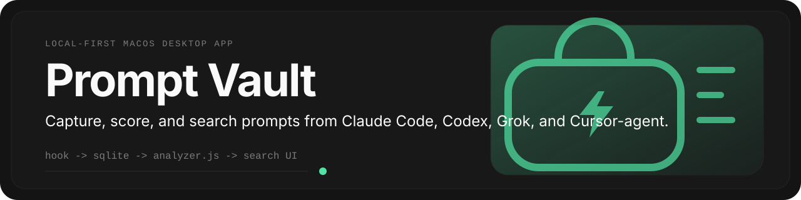
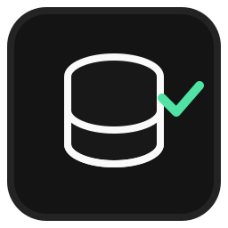
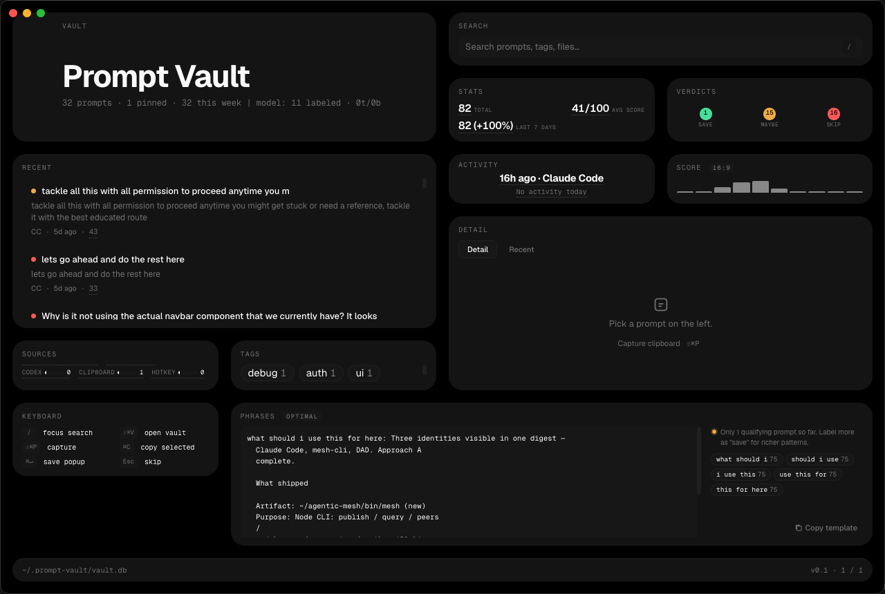
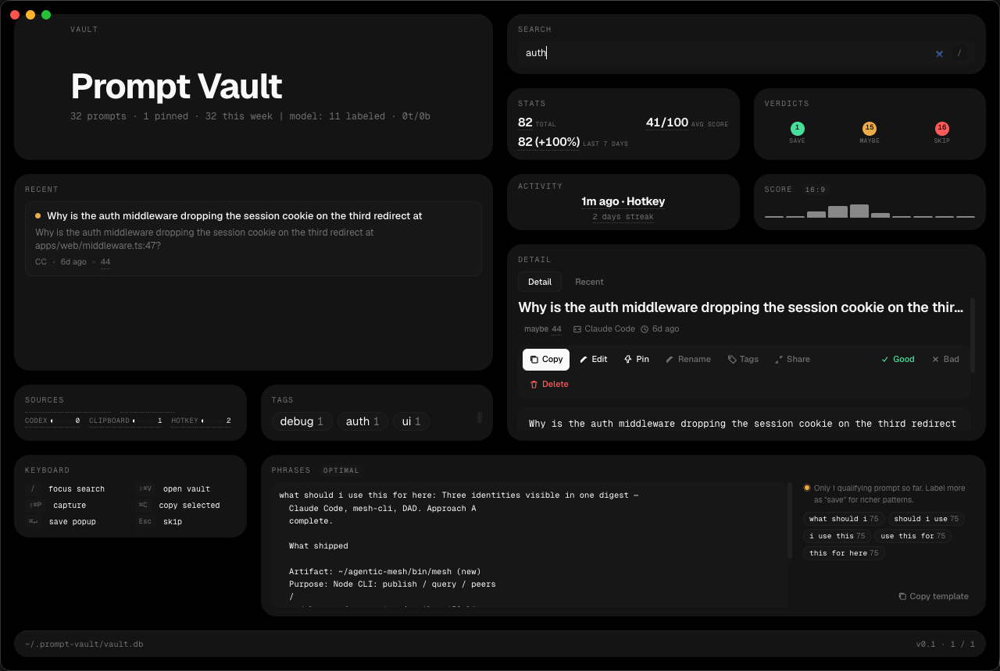
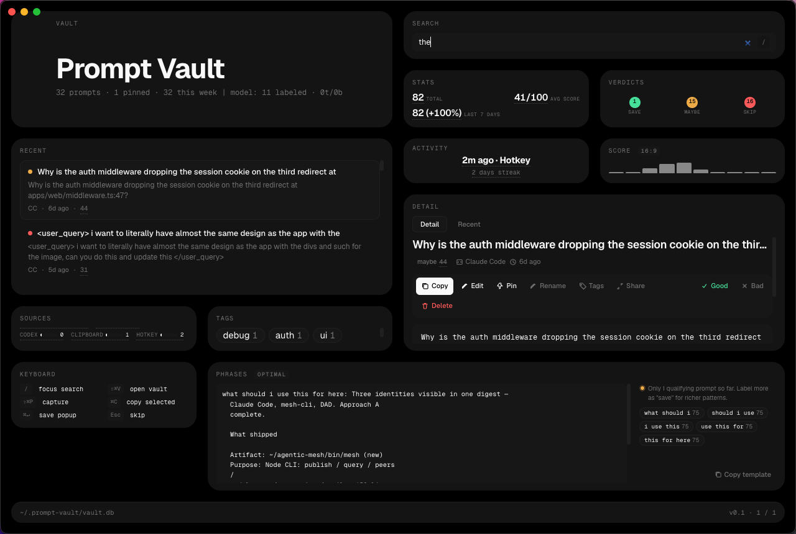

<p align="center">
  
</p>

<p align="center">
  
  
  
  <a href="https://github.com/DevvGwardo/prompt-vault/releases"></a>
</p>

Prompt Vault is a local-first desktop app for macOS and Windows that captures the prompts you send through agent tooling, scores them offline, and makes them searchable later. It stores data in SQLite with `better-sqlite3`, analyzes prompt quality in `analyzer.js`, and surfaces everything in an Electron renderer built for fast keyboard-heavy browsing.

## Features

| | |
| --- | --- |
|  | **Capture from your real workflow**. Prompt Vault accepts prompts through its local hook flow, including Claude Code hook wiring and active watchers for Codex and Grok sessions. |
|  | **Score prompts offline**. `analyzer.js` assigns a score, verdict, and reasons so you can separate strong prompts from throwaways. |
|  | **Search fast**. Prompts are stored in SQLite and indexed with FTS5 for quick search across text, title, and tags. |
|  | **Stay local-first**. The vault lives in `~/.prompt-vault/vault.db` by default, with no cloud service required. |

## Supported Agents

- Claude Code (CLI and desktop app)
- Codex (CLI and desktop app)
- Grok
- Cursor-agent
- Hermes
- Anything else, via the clipboard watcher, the global save hotkey, or `pv-capture`

## Install

Download the latest build from [GitHub Releases](https://github.com/DevvGwardo/prompt-vault/releases):

- **macOS** — `.dmg` (Apple Silicon and Intel)
- **Windows** — `Prompt-Vault-Setup-x.y.z.exe` installer, or the portable `.exe`. The build is unsigned, so Windows SmartScreen may warn "unknown publisher" — click **More info → Run anyway**.

## Build From Source

```bash
npm install
npm start
npm run dist      # macOS build (run on macOS)
npm run dist:win  # Windows build (run on Windows)
```

## Set Up Capture

Codex, Grok, Hermes, and Claude desktop-app prompts are captured automatically while the app is running — it watches their session directories (`~/.codex/sessions`, `~/.grok/sessions`, `~/.hermes-chat/sessions`, `~/.claude/projects`). If a tool isn't installed, its watcher simply stays off.

For the Claude Code CLI and cursor-agent, run the interactive installer from a checkout:

```bash
node cli/bin/pv.js install-hooks      # wires detected CLIs; prompts before each
node cli/bin/pv.js uninstall-hooks    # removes everything it added
```

You can also capture from any tool manually with `hook/pv-capture --source mytool --stdin`.

## Hotkeys

| Shortcut | Action |
| --- | --- |
| `Cmd/Ctrl+Shift+P` | Save current clipboard as a prompt |
| `Cmd/Ctrl+Shift+S` | Quick-save the pending captured prompt |
| `Cmd/Ctrl+Shift+K` | Quick Pick — search and copy a saved prompt |
| `Cmd/Ctrl+Shift+V` | Open the vault window |

## How It Works

1. A local hook or watcher captures a prompt from your agent workflow.
2. Prompt Vault stores the prompt, metadata, and recent activity in SQLite.
3. `analyzer.js` scores the prompt and attaches a verdict plus reasons.
4. The Electron renderer lets you search, inspect, pin, and revisit prompts in the vault UI.

## Data & Uninstall

Everything lives in `~/.prompt-vault/` (override with the `PROMPT_VAULT_DIR` env var) — no cloud, no telemetry. The app also runs a local-only HTTP listener on `127.0.0.1:8765` to receive prompts from hooks. To fully remove Prompt Vault: run `uninstall-hooks` (above), delete the app, and delete `~/.prompt-vault/`.

## Screenshots

<p align="center">
  
</p>
<p>
  
  
</p>

## License

MIT
